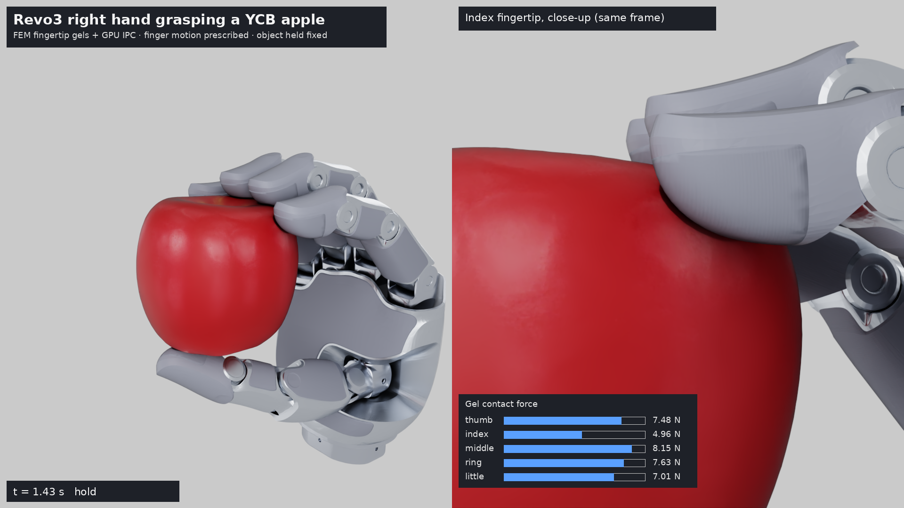
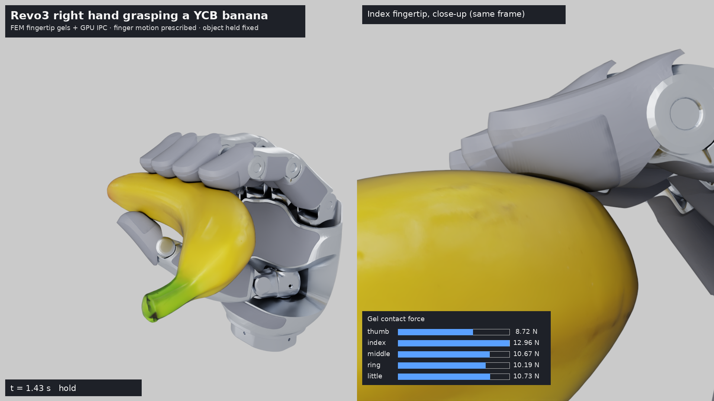
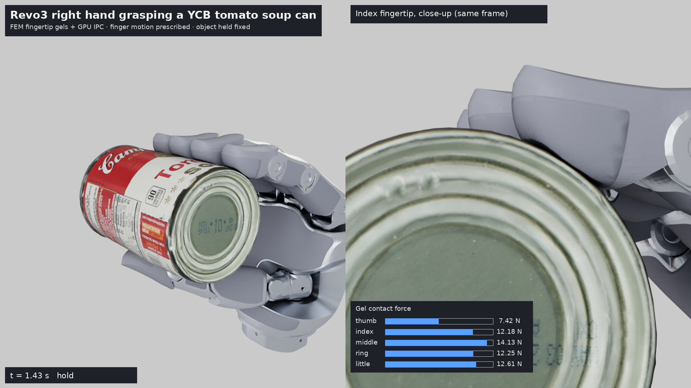
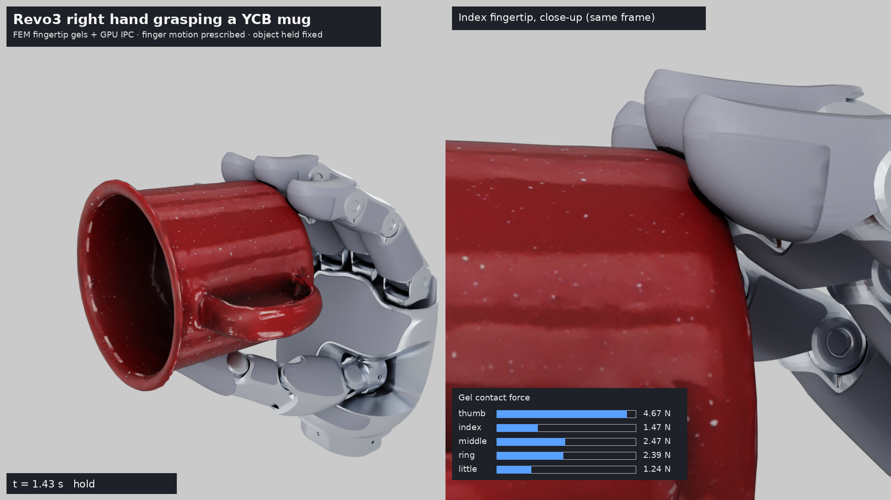

# Revo3 hand · YCB grasp with simulated fingertip gels

A self-contained demo of the Revo3 right hand grasping six YCB objects (apple, orange, banana,
tomato soup can, mug, mustard bottle). The five fingertip gels are complete FEM volumes simulated on
the GPU with IPC contact and friction, so you can watch them deform and read the contact force on
each pad. Everything runs from this repository: solver code, hand and gel geometry, object scans
and precomputed grasp plans.

Video of all six grasps (half speed): [docs/media/grasp_all_ycb_halfspeed.mp4](docs/media/grasp_all_ycb_halfspeed.mp4)

|  |  |
|---|---|
|  |  |

## What is simulated, and what is not

| | |
|---|---|
| Fingertip gels | Physical. 5 complete gels, 7,756 nodes / 26,546 tetrahedra; stable Neo-Hookean, 2x stiffness; GPU IPC contact with friction (mu 0.5); implicit 1/30 s steps accepted only when the force residual is <= 1e-6 N and every inversion / path check passes. |
| Finger motion | **Prescribed.** Joint angles follow a curl synergy (MCP/PIP/DIP coupled); each gel stays pinned to its fingertip link, posed by the hand's forward kinematics. |
| Object | **Prescribed and fixed in space.** No mass or gravity; it is squeezed, never lifted. |
| Other hand links | Visual only. The grasp planner keeps them >= 0.8 mm from the object (palm 1.6 mm). |
| Contact surface | A closed, decimated copy of each scan (within 0.21 mm of it; mustard bottle 1.09 mm because its scan needed a voxel remesh). The textured scan is what you see. |

The solver is the "prescribed-motion" fingertip solver from the `newton-tactile-simulation`
project (`vbd_tactile.revo3.Revo3TactileHand`, rigid-mesh mode), vendored unchanged in
[`src/vbd_tactile`](src/vbd_tactile/VENDORED.md). Newton provides the model and state containers;
the time step is that project's own Warp GPU FEM/IPC solver, not one of Newton's built-in solvers.

## Results (scripted grasp: approach, squeeze, hold, release; 81 steps of 1/30 s)

| Object | Pads in contact | Peak pad force | Mean / max step time |
|---|---|---|---|
| Apple | 5 | 5.0–8.2 N | 334 / 1265 ms |
| Orange | 5 | 4.8–13.5 N | 371 / 1672 ms |
| Banana | 5 | 8.7–13.0 N | 406 / 2635 ms |
| Tomato soup can | 5 | 7.4–14.2 N | 434 / 1441 ms |
| Mug (0.6 mm closure) | 5 | 1.2–4.7 N | 273 / 1258 ms |
| Mustard bottle | thumb, index, middle | 10.7–15.2 N | 393 / 1437 ms |

Measured on one RTX-class GPU; times exclude rendering and are not real time. Fingers close 1 mm
past first touch (rigid-equivalent), which compresses the gels close to the solver's 0.05 element
volume floor. The mug at 1 mm was rejected mid-squeeze (thin wall), so it uses 0.6 mm. On the
mustard bottle the ring and little fingers would hit it with their middle links first, so they stop
short.

## Install

Linux with an NVIDIA GPU (CUDA 12):

```bash
uv venv -p 3.12 .venv && source .venv/bin/activate
uv pip install -e .
```

The first run compiles the CUDA kernels (several minutes); they are cached in `~/.cache/warp`.

## Interactive demo

```bash
python -m revo3_grasp.app --port 8080           # on the GPU machine
```

If the GPU machine is remote, forward the port and open <http://localhost:8080>:

```bash
ssh -L 8080:localhost:8080 <gpu-host>
```

- **Object** dropdown switches between the six YCB objects (rebuilds the scene, ~20–40 s once
  kernels are cached).
- **Grip (all)** moves every finger: 0 = open, the `touch` mark = the pad just reaches the object,
  1 = 1.5 mm of commanded closure past touch. Untick *Move all fingers together* to drive each finger
  with its own slider.
- **Contact force** shows each pad's live contact force (bars full at 15 N) and its commanded closure.

Each slider change is followed in rate-limited 1/30 s physics steps (closure past touch advances at
most 0.15 mm per step). If the solver rejects a step, the state is left unchanged and the step size is
halved automatically.

## Scripted grasp and rendering

```bash
python -m revo3_grasp.run_grasp --object 013_apple --output outputs/013_apple
```

writes `states.npz` (gel positions, curls and pad forces per step) and `report.json`. Add `--dt 0.016666666666666666`
to simulate 1/60 s steps; every saved step is one video frame, so the render plays in real time
at 60 fps (the renderer reads the step size from `report.json` for its time labels).

The path-traced videos were rendered with Isaac Sim 5.1 from the textured Revo3 hand USD
(`revo3_right_bionic_silver.usda`, not included here):

```bash
PYTHONPATH=src <isaac-sim-python> -m revo3_grasp.render_isaac --usd <path>/revo3_right_bionic_silver.usda \
  --states outputs/013_apple/states.npz --model assets/ycb/013_apple --output outputs/013_apple/render \
  --title "Revo3 right hand grasping a YCB apple" --wide-dist 0.30 --close-dist 0.13 \
  --close-view 0.25,1,-0.05 --close-shift 0.25,0,0
ffmpeg -framerate 30 -i outputs/013_apple/render/frames/%04d.png -pix_fmt yuv420p apple.mp4   # use 60 for 1/60 s states
```

## Adding another YCB object

```bash
uv pip install -e '.[plan]'                       # open3d for signed distances / decimation
scripts/fetch_ycb.sh 014_lemon                    # scan + closed physics mesh
python -m revo3_grasp.planning.plan_grasp --mesh assets/ycb/014_lemon/physics.ply \
  --output assets/ycb/014_lemon/plan.json --orientations all
```

then add it to `OBJECT_LABELS` in `src/revo3_grasp/paths.py`. The planner searches object
placements and per-finger curl profiles so that each gel touches first (no other link within
0.8 mm), then adds a fixed rigid closure (`--depth-mm`, default 1.0; `planning/replan_depth.py`
re-solves an existing plan for another depth).

## Layout

```
src/vbd_tactile/      vendored GPU FEM/IPC solver subset (96 modules, unchanged)
src/revo3_grasp/      demo: hand_fk, synergy, sim (GraspSession), run_grasp, app, render_isaac, planning/
assets/revo3/         fingertip gel meshes (5 x .npz), hand joints and link meshes
assets/ycb/<id>/      textured scan, closed physics mesh, grasp plan
scripts/              fetch_ycb.sh, smoke_app.py (headless app test)
docs/media/           compilation video and stills
```

## Credits

- YCB object models: Calli et al., "The YCB object and model set", ICAR 2015 / IJRR 2017,
  <https://www.ycbbenchmarks.com>, google_16k scans, licensed CC BY 4.0.
- Physics built on [Newton](https://github.com/newton-physics/newton) and
  [NVIDIA Warp](https://github.com/NVIDIA/warp).
- The Revo3 hand link meshes and fingertip gel meshes in `assets/revo3` come from the Revo3 hand
  model.
